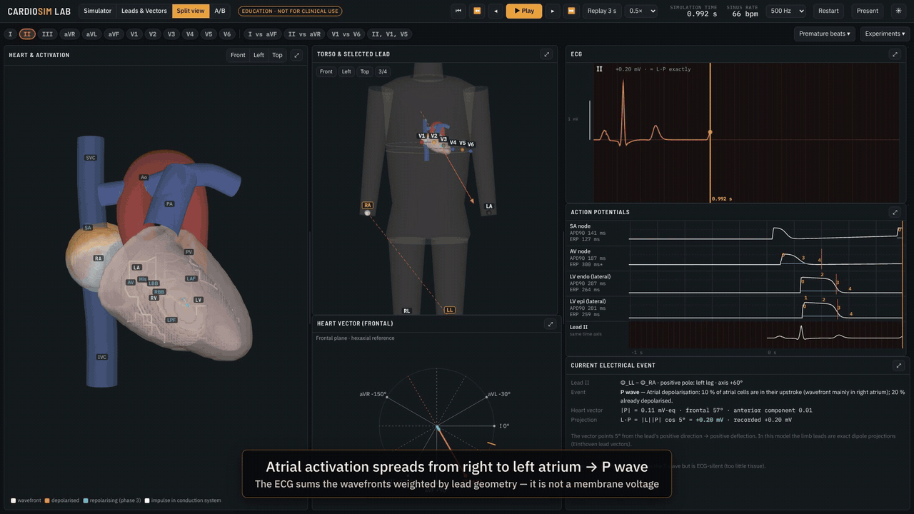

# CardioSim Lab

Interactive cardiac electrophysiology and 12-lead ECG simulator. One causal simulation links cell action potentials, spatial activation of an idealised heart and a forward-computed 12-lead ECG on a single clock. Change a parameter, and the ECG changes because the simulated electrophysiology changed.

<p align="center">
  <a href="docs/media/CardioSim-demo.mp4"></a>
</p>
<p align="center"><sub>28-second preview, recorded from the running app: normal activation → lead vectors → premature ventricular complex → normal vs LBBB (A/B view).<br><b><a href="docs/media/CardioSim-demo.mp4">Watch the full narrated demo (4 min 21 s, MP4, 1080p, 21 MB)</a></b></sub></p>

> **Research education and concept demonstration only.** This is not a clinically validated diagnostic system or a patient-specific prediction tool, and it does not predict clinical drug effects.

## Quick start

### Option A — no installation
Double-click **`CardioSim-standalone.html`** and open it in a recent Chrome, Edge or Firefox. Everything is inside that one file. Without internet the fonts fall back to system fonts; nothing else changes.

### Option B — development version (Windows, macOS, Linux)
Requires **Node.js 20.19+ or 22.12+** (https://nodejs.org).

```powershell
cd D:\ECG\cardiosim-lab
npm install
npm run dev          # opens http://localhost:5173
```

| Command | What it does |
|---|---|
| `npm run dev` | Development server with hot reload |
| `npm run build` | Type-check and build a static site in `dist/` (serve with `npm run preview`) |
| `npm run build:standalone` | Build one self-contained HTML file in `dist-standalone/index.html` |
| `npm test` | 89 physiology / scenario / ionic / ECG unit tests (Vitest, about 5 min) |
| `npm run test:e2e` | 20 browser tests (Playwright). First time: `npx playwright install chromium` |
| `npm run validate` | Prints a baseline report: ECG-measured intervals vs model timings vs references |

## Using the app

Four **modes** (top bar):

| Mode | Contents |
|---|---|
| **Simulator** | **A · Anatomy & activation:** smooth 3-D heart with toggleable layers (anatomy, major conduction pathways, activation, repolarisation, refractoriness, vectors, tissue mesh), presets for anterior, posterior, left-lateral and superior views, and click-to-select. Great vessels are shown for orientation only. **B · Action potentials:** reduced-order APs for selected cells. **C · 12-lead ECG:** 3×4 + rhythm strip (6×2 on narrow screens) or selected leads; calipers, Inspect and SVG/PNG/CSV export; measurements next to model truth; a causal event log (click an event to highlight the structure and read what it means). **D · Controls:** Scenarios (registry with implementation status), Parameters, Explain, Lessons, **Ionic cell** (TP06), Validation, A/B and About. |
| **Leads & Vectors** | Torso with RA/LA/LL/RL and V1–V6 electrodes; lead axes (solid = positive half), wiring to the Wilson central terminal, projection bar, optional lead-field proximity map; hexaxial frontal plane with QRS loop and measured axis; horizontal plane with the effective chest-lead vector and its R². Compare up to three leads. The **Experiments** menu runs A–F. |
| **Split view** | Heart, torso, frontal vector, ECG strip, action potentials and the current electrical event, all on one clock. |
| **A/B** | Two parameter sets simulated from t = 0 and animated side by side, with an ECG overlay at identical scaling and the list of differences. |

Panels can be resized by dragging the dividers and maximised with ⤢ (Esc restores). **Present** switches to full-screen with larger type.

**Keyboard.** Space play/pause · ← → step 20 ms · [ ] previous/next beat.

**Live changes.** In *live* mode a parameter change takes effect at the current display time. The simulation is replayed deterministically up to that point and continues with the new value. Use *restart* to begin again at t = 0.

**Save/Load.** Scenarios are JSON files containing the full parameter set and sampling rate.

## What is and is not simulated

| Mechanistic or reduced-order and runnable | Partial | Not supported (labelled, not runnable) |
|---|---|---|
| Sinus rhythm and rate changes, sinus arrest, SA exit block, 1° AV block, Mobitz I and II, 2:1 and complete AV block with escape rhythms, PACs, PVCs (compensatory and interpolated), bigeminy, trigeminy, couplets (also on demand: *Premature beats* controls), focal AT, AVNRT, orthodromic and antidromic AVRT, pre-excitation, typical atrial flutter, atrial fibrillation, LBBB; RBBB (axis incomplete) | Focal VT (automaticity imposed); IKr inhibition, short QT, hyper-/hypokalaemia, Na⁺ and Ca²⁺ channel block via the TP06 ionic cell model mapped to tissue APD/CV | Scar VT, polymorphic VT, TdP, VF, hyper-/hypocalcaemia, EAD/DAD propagation, drug-specific arrhythmias |

The status of every scenario is in `docs/scenario-registry.json`; limitations are in `SCIENTIFIC_LIMITATIONS.md`. The details are in `docs/FIDELITY_MATRIX.md`. The baseline (default parameters, measured from the simulated ECG) is HR 66, PR 156 ms, QRS 84 ms, QT 372 ms, QTc 390 ms and QRS axis +18°; the model gives AH 65 ms and HV 41 ms.

## Documentation
- `DEVELOPMENT_STATUS.md`, `IMPLEMENTATION_BACKLOG.md`, `SCIENTIFIC_LIMITATIONS.md`, `TEST_RESULTS.md`, `NEXT_SESSION.md`
- `docs/scenario-registry.json`: machine-readable scenario status (regenerate with `npx tsx scripts/export-registry.ts`)
- `docs/ARCHITECTURE.md`: layered model, runtime architecture, folder/module structure
- `docs/FIDELITY_MATRIX.md`: fidelity levels, output classes, limitations
- `docs/PARAMETER_DEPENDENCIES.md`: causal graph, defaults with evidence tags, planned parameters
- `docs/ROADMAP.md`: phased plan and next priorities
- `docs/VALIDATION.md`: what the tests check
- `docs/REFERENCES.md`: sources (with DOIs/PMIDs) and which values have none
