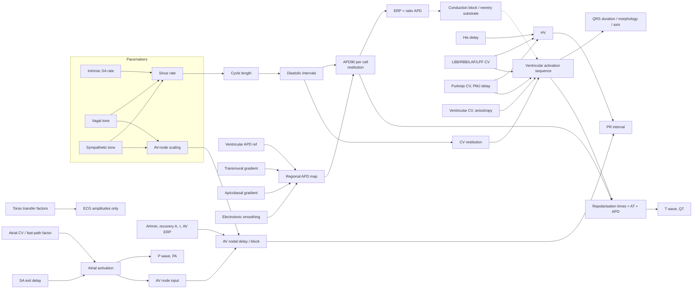

# Parameter Dependency Model

All parameters live in one typed, serialisable object, `SimParams` (`src/simulation/core/params.ts`). Each parameter carries units, range, reference value, affected structure, mechanism, predicted effect and an **evidence tag**:

- `literature`: the default is taken from a cited human measurement.
- `calibrated`: tuned so that a cited emergent quantity (AH, HV, QT…) falls in range.
- `nominal`: a plausible teaching value with **no** direct data source.

## 1. Causal graph (implemented, Phase 1)

## 2. Dependency table (implemented)

| Parameter | Default | Tag | Directly changes | Downstream ECG effect |
|---|---|---|---|---|
| Intrinsic SA rate | 92 bpm | literature (Jose & Collison 1970) | SA firing | RR; QT (via APD restitution); PR (AV recovery) |
| Vagal / sympathetic tone | 0.5 / 0.1 | nominal | SA rate; AV-node scaling | RR, PR |
| SA exit delay | 10 ms | nominal | SA → atrium | none at constant rate |
| Junctional / ventricular escape | 45 / 30 bpm | nominal | latent automaticity | none in NSR; escape rhythms after failure |
| Atrial CV | 0.9 m/s | literature (van Schie 2021) | atrial delays | P duration, PA, PR |
| Bachmann/crista factor | 1.6 | nominal | interatrial conduction | P duration / notching |
| Atrial APD, ERP ratio | 220 ms, 0.95 | nominal | atrial recovery | Ta wave (hidden) |
| AHmin | 65 ms | calibrated (AH 76 ± 16 ms) | AV nodal delay | PR |
| AV recovery amplitude / τ / ERP | 180 ms / 90 ms / 300 ms | nominal (form: Sun 1995) | rate-dependent AH, block | PR at high rate; dropped beats |
| His conduction time | 18 ms | literature (His potential 19 ± 3 ms) | HV | PR |
| LBB/RBB/LAF/LPF CV | 1.5 m/s | nominal, calibrated with HV | bundle delays | QRS width/morphology/axis |
| Purkinje CV, PMJ delay | 3.0 m/s, 8 ms | nominal | endocardial spread, HV | QRS width, PR |
| Ventricular CV, anisotropy | 0.6 m/s, 2.0 | nominal (order of magnitude, Kléber & Rudy 2004) | myocardial spread | QRS width |
| Ventricular APD ref | 300 ms @ CL 1000 | calibrated (QTc ≈ 390) | all ventricular APDs | QT/QTc |
| Transmural gradient | 25 ms (endo > epi) | calibrated (Franz 1987 RT difference) | repolarisation order | T polarity/amplitude |
| Apicobasal gradient | −30 ms (apex < base) | nominal; sign varies in humans (Opthof 2017) | repolarisation order | T polarity in inferolateral leads |
| ERP / APD ratio | 0.92 | nominal | refractoriness | block, premature beats |
| Electrotonic smoothing | 4 mm | nominal (model device) | APD map | T amplitude |
| CV restitution a / τ | 0.5 / 30 ms | nominal | CV at short DI | premature beats |
| Torso transfer factors | 2.5 / 0.8 | calibrated (amplitudes) | amplitudes | amplitudes only |

The app warns about values outside physiological ranges and about non-physiological combinations, for example AV ERP + AH > sinus cycle, APD > 60 % of the cycle, or rates above 180 or below 35 bpm.

## 3. Planned parameters (from the specification) and the phase that adds them

| Group | Parameter | Phase | Mechanism needed |
|---|---|---|---|
| Pacemaker | Sinus pause probability; automaticity strength (phase‑4 slope); RSA | 2 | Stochastic SA model (seeded RNG is already wired) |
| AV node | Functional refractory period; decremental conduction with fatigue/facilitation; concealed conduction; fast/slow pathways; block probability | 2–3 | Full Sun–Glass–Billette recursion; dual-pathway nodal network |
| Atria | Fibrosis burden/distribution; CV heterogeneity; ectopic focus location/rate/timing; reentry substrate | 2–3 | Per-voxel CV/ERP maps; ectopic pacemaker nodes |
| His–Purkinje | Regional block switches; Purkinje refractory period separate from APD | 2 | Block flags per segment |
| Ventricles | Scar burden; excitability; ectopic focus; triggered-activity propensity | 3–5 | Non-conducting voxels, source–sink rule, triggered events |
| Ionic | INa, INa,L, ICa,L, IKr, IKs, IK1, Ito, IKATP, If, Ca handling, EAD/DAD | 4 | Level‑3 cell model (ten Tusscher–Panfilov 2006 candidate) mapped to APD/ERP tables |
| Environment/pharmacology | [K⁺]o, [Ca²⁺]o, ischaemia severity, Na/IKr/CaL inhibition, multichannel | 4–5 | Ionic model plus documented, non-clinical exposure assumptions |

No parameter will be presented as predicting clinical drug effects without validated exposure–response and electrophysiological models.
